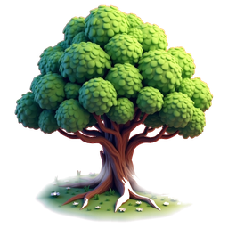
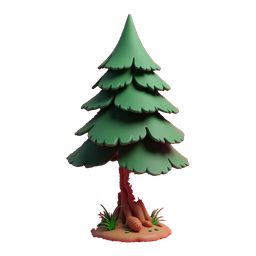
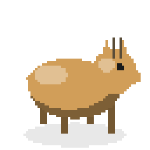
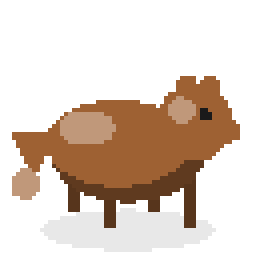
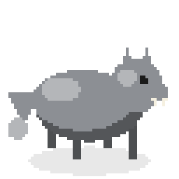
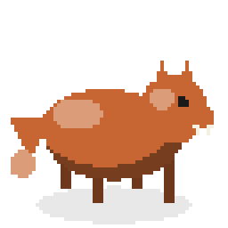

<div align="center">

# 🌳 1M Trees

**Rebuild Earth's ecosystem, one tree at a time.**

A calm, idle-friendly mobile game built in Unity. You play a scientist on a government grant.
You plant forests, grow a working food chain and research new species.


</div>

---

## About

You start on a bare, lifeless plot with a small laboratory and a government budget of **Funds**.
You spend Funds to plant trees and release animals. Herbivores need enough trees to live on,
and predators need enough prey to hunt. The bigger your ecosystem grows, the more the
government gives you each day. Your land expands, and the plot slowly turns into a dense,
biodiverse forest.

### Design pillars

1. **Every tap grows something real.** Virtual progress should feel tied to real-world impact.
2. **Calm, not grindy.** It's satisfying whether you play for 30 seconds or 10 minutes.
3. **Visible impact.** You can always see your progress in plain numbers.
4. **Biodiversity over monoculture.** The food chain rewards a varied ecosystem.
5. **Discovery feels earned.** Research feels like scientific progress, not a paywall.

## Screenshots

| | |
|:---:|:---:|
|  |  |
| **A grove spreading along the river** | **New trees greening the soil around them** |
|  |  |
| **The golden boundary of your land** | **Hand-tuned oak tree art** |

<p align="center">
  <br>
  <b>The Laboratory, your research hub</b>
</p>

## Trees & animals

The world has two trees and four animals. Each habitat type has one species you start with
and one you unlock through research at the Laboratory.

### 🌳 Trees

| | Tree | How you get it | Cost | Growth (seedling → sapling → mature) |
|:---:|---|---|:---:|---|
|  | **Oak** | Unlocked from the start | 10 Funds | 1 min → 5 min → 15 min |
|  | **Pine** | Lab research (3 min) | 10 Funds | 45 s → 4 min → 12 min |

Trees grow through three stages and green the soil around them as they mature. Tap a tree that
is still growing to finish it instantly for gems. Trees can't be planted in the river or right
next to the Laboratory.

### 🦌 Herbivores

| | Animal | How you get it | Release cost | Needs | Behaviour |
|:---:|---|---|:---:|---|---|
|  | **Gazelle** | Unlocked from the start | 50 Funds | 1 gazelle per 20 trees | Roams freely around the spot where it was released. It's the wolf's prey. |
|  | **Squirrel** | Lab research (3 min) | 50 Funds | 1 squirrel per 2 trees | Stays close to the nearest tree. About once a minute it heads off on a longer trip before settling at a tree again. It's the fox's prey. |

### 🐺 Predators

| | Animal | How you get it | Release cost | Needs | Behaviour |
|:---:|---|---|:---:|---|---|
|  | **Wolf** | Unlocked from the start | 200 Funds | At least 5 gazelles, and 1 wolf per 5 gazelles | Wanders the land and sometimes chases a nearby gazelle. |
|  | **Fox** | Lab research (6 min) | 200 Funds | At least 5 squirrels, and 1 fox per 5 squirrels | Wanders the land and sometimes chases a nearby squirrel. |

**How animals behave**

- **Releasing:** pick an animal in the HUD, then tap a spot on your land to release it there. The release only works if the ecosystem can support another one (see **Needs**). There's no random chance involved.
- **Moving around:** animals wander in a small area and play a 2-frame walk cycle. They avoid walking across the river.
- **Hunting:** each time a predator picks somewhere new to go, it has a 10% chance to chase a prey animal within range instead. The chase is for show only, so prey numbers don't drop.
- **Tap to identify:** tapping an animal shows its name above it for about a second and a half. While the name is showing, the animal glows green if it's a herbivore or red if it's a predator.

> The tree pictures are the game's own textures. Animals in the game are drawn by code at
> runtime, and the pictures above were made by running a Python copy of that code with each
> species' colours and features.

## Features

- 💰 **Government Funds:** you start with 300 Funds. Each day the government adds a budget of 300, plus 1 for every tree you have, plus 50 for every species you've unlocked, plus any milestone bonuses. Planting and releasing cost Funds, and a Store panel lists every price.
- 🦌 **Food-chain release:** you release animals by hand, but only when the ecosystem can support them. Herbivores need enough trees, and predators need enough prey.
- 🔬 **Laboratory:** a research panel split into Plants, Herbivores and Predators tabs. Research one project at a time, and skip the wait with gems.
- 📖 **The Codex:** a book-style catalogue of every species, showing what each one needs before you can release it.
- 🗺️ **Territory & minimap:** grow from a 20×20 plot to the full 60×60 map. You find the edge of your land by bumping into it, and you can drag the minimap to move around.
- ⭐ **Levels, XP & milestones:** planting a tree or releasing an animal earns 5 XP, a research unlock 20 and a milestone 50. Milestones also give gems and raise your daily Funds.
- ⚡ **Growth boost:** tap a growing tree to finish it instantly with gems.
- 🎨 **Art & UI:** painted textures for the trees, ground, river and Laboratory, plus a UI built on a shared design-token system. Plants and creatures that don't have their own art yet are drawn procedurally.
- 🔊 **Sound settings:** separate music and SFX volume and mute controls that persist between sessions.

## Getting started

### Requirements

- **Unity 6000.5.6f1** (use [Unity Hub](https://unity.com/download) to install this exact version)
- iOS and/or Android build support modules, if you want to build to a device

### Run it

```bash
git clone https://github.com/Amine-mdidech/1M-Tree.git
```

1. Open the cloned folder in Unity Hub (**Add → Add project from disk**).
2. Open `Assets/Scenes/MainMenu.unity`.
3. Press **Play**. The game is designed for landscape, so set the Game view to a landscape phone resolution.

> 💡 The **demo button** in the HUD opens a demo-tools panel. Use it to grant gems,
> unlock everything, finish research, mature trees or reset your save, all without grinding.

### Run the tests

Open **Window → General → Test Runner**, choose **EditMode** and click **Run All**. The suite
covers the core game logic: economy, emergence, milestones, research, saving, tree planting and
the species roster.

## Project structure

```
Assets/
├── Scenes/           MainMenu + SampleScene (gameplay)
├── Scripts/
│   ├── Economy/      Gems, daily grant
│   ├── Ecosystem/    Emergence system, creatures, ecosystem state
│   ├── Milestones/   Milestones, player level & XP
│   ├── Research/     Laboratory and tech-tree projects
│   ├── Save/         Save/load and save summaries
│   ├── Species/      Species definitions
│   ├── Vegetation/   Tree planting, growth, camera panning
│   ├── World/        Land tiers, ground, rivers, VFX
│   ├── UI/           HUD, Codex, Lab, Profile, Settings, main menu
│   ├── Audio/        Procedural audio
│   └── Tests/        EditMode unit tests
├── Data/             ScriptableObject data (species, vegetation, research, milestones)
└── UI/               UI Toolkit documents and styles
docs/                 Design documents, specs and plans
```

## Documentation

| Document | What's inside |
|---|---|
| [Game Design Document](docs/game-design-document.md) | Concept, core loop, every mechanic, scope |
| [Game Data Specs](docs/game-data-specs.md) | Species, vegetation, research and balancing numbers |
| [Art Design Document](docs/art-design-document.md) | Procedural art direction |
| [UI Style Guide](docs/ui-style-guide.md) | Design tokens, components and navigation |
| [Launch Readiness](docs/launch-readiness.md) | What's left before release |

## Roadmap

Not built yet:

- [ ] Rewarded video ads and the in-app purchase flow
- [ ] NGO partnership, so real profits fund real reforestation, with a public impact counter
- [ ] A global shared counter of real trees funded
- [ ] Multiple biomes
- [ ] Lab upgrades (faster research, more research slots)
- [ ] Real predation (predators reducing prey population)

---

<div align="center">
Made with 💚 for the planet.
</div>
