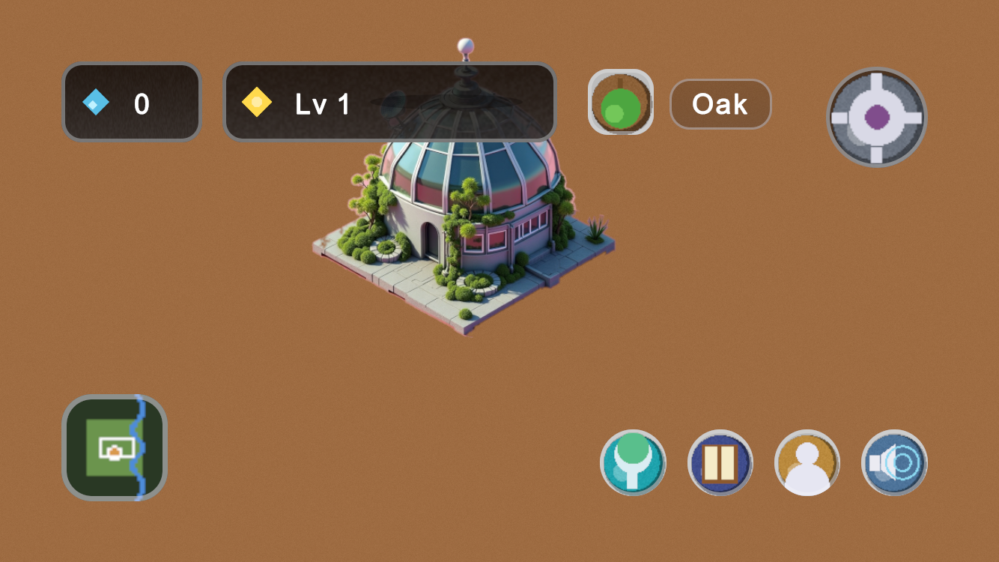
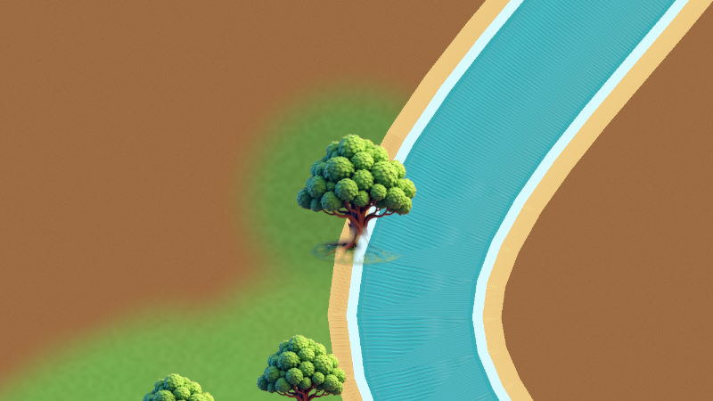
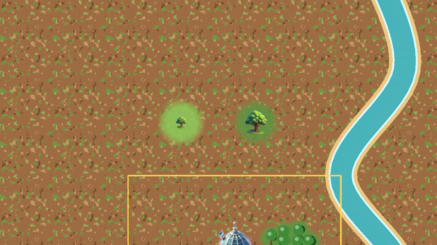
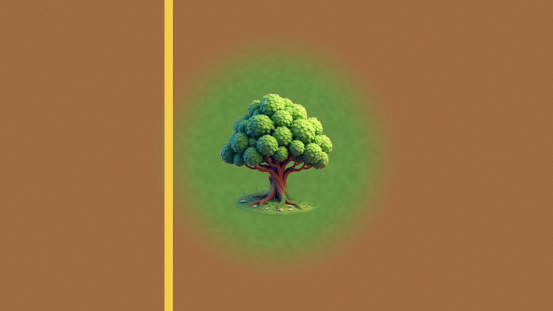
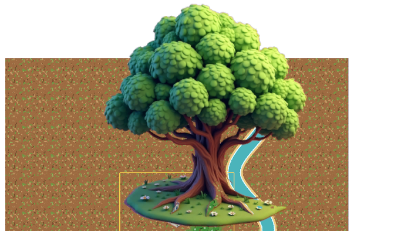
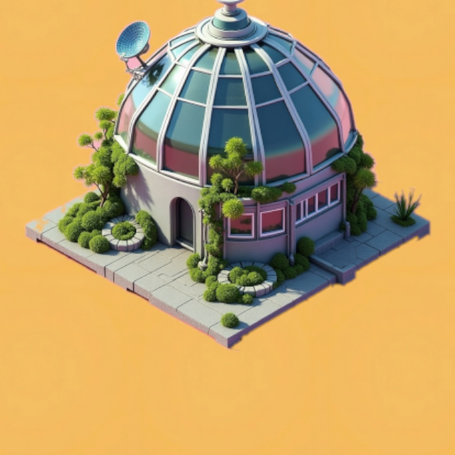

<div align="center">

# 🌳 1M Trees

**Rebuild Earth's ecosystem, one tree at a time.**

A calm, idle-friendly mobile game built in Unity. You play a scientist on a government grant.
You plant forests, grow a working food chain and research new species.




</div>

---

## About

You start on a bare, lifeless plot with a small laboratory and a grant of **30 trees per day**.
Each tree you plant raises the chance that wildlife shows up. Herbivores arrive first. Predators
come only once there is enough prey to feed them. As you prove results, your funding grows,
your land expands, and the plot slowly turns into a dense, biodiverse jungle.

### Design pillars

1. **Every tap grows something real.** Virtual progress should feel tied to real-world impact.
2. **Calm, not grindy.** It's satisfying whether you play for 30 seconds or 10 minutes.
3. **Visible impact.** You can always see your progress in plain numbers.
4. **Biodiversity over monoculture.** The food chain rewards a varied ecosystem.
5. **Discovery feels earned.** Research feels like scientific progress, not a paywall.

## Screenshots

| | |
|:---:|:---:|
|  |  |
| **A grove spreading along the river** | **New trees greening the soil around them** |
|  |  |
| **The golden boundary of your land** | **Hand-tuned oak tree art** |

<p align="center">
  <br>
  <b>The Laboratory, your research hub</b>
</p>

## Features

- 🌱 **Daily grant:** a real-time daily tree allowance, framed as grant funding rather than an energy bar. Hitting milestones raises it.
- 🦌 **Food-chain emergence:** species appear on their own, based on tree count and vegetation diversity. Predators are gated by prey population (for example, 1 wolf per 8 gazelles once there are 15 or more).
- 🔬 **Laboratory tech tree:** 24 research projects (10 plants and 14 animals) across 5 tiers, linked by prerequisites.
- 📖 **The Codex:** a book-style catalogue of every species, with real facts, conservation status and the exact conditions it needs to appear.
- 🗺️ **Territory & minimap:** grow from a 20×20 plot to the full 60×60 map. You find the edge of your land by bumping into it, and you can drag the minimap to move around.
- ⭐ **Levels, XP & milestones:** planting, research and achievements earn XP and gems.
- ⚡ **Growth boost:** tap a growing tree to finish it instantly with gems.
- 🎨 **Art & UI:** painted textures for the trees, ground, river and Laboratory, plus a UI built on a shared design-token system. Plants and creatures that don't have their own art yet are drawn procedurally.
- 🔊 **Sound settings:** separate music and SFX volume and mute controls that persist between sessions.

## Getting started

### Requirements

- **Unity 6000.5.6f1** (use [Unity Hub](https://unity.com/download) to install this exact version)
- iOS and/or Android build support modules, if you want to build to a device

### Run it

```bash
git clone https://github.com/Amine-mdidech/1M-Tree.git
```

1. Open the cloned folder in Unity Hub (**Add → Add project from disk**).
2. Open `Assets/Scenes/MainMenu.unity`.
3. Press **Play**. The game is designed for landscape, so set the Game view to a landscape phone resolution.

> 💡 The **demo button** in the HUD opens a demo-tools panel. Use it to grant gems,
> unlock everything, finish research, mature trees or reset your save, all without grinding.

### Run the tests

Open **Window → General → Test Runner**, choose **EditMode** and click **Run All**. The suite
covers the core game logic: economy, emergence, milestones, research, saving, tree planting and
the species roster.

## Project structure

```
Assets/
├── Scenes/           MainMenu + SampleScene (gameplay)
├── Scripts/
│   ├── Economy/      Gems, daily grant
│   ├── Ecosystem/    Emergence system, creatures, ecosystem state
│   ├── Milestones/   Milestones, player level & XP
│   ├── Research/     Laboratory and tech-tree projects
│   ├── Save/         Save/load and save summaries
│   ├── Species/      Species definitions
│   ├── Vegetation/   Tree planting, growth, camera panning
│   ├── World/        Land tiers, ground, rivers, VFX
│   ├── UI/           HUD, Codex, Lab, Profile, Settings, main menu
│   ├── Audio/        Procedural audio
│   └── Tests/        EditMode unit tests
├── Data/             ScriptableObject data (species, vegetation, research, milestones)
└── UI/               UI Toolkit documents and styles
docs/                 Design documents, specs and plans
```

## Documentation

| Document | What's inside |
|---|---|
| [Game Design Document](docs/game-design-document.md) | Concept, core loop, every mechanic, scope |
| [Game Data Specs](docs/game-data-specs.md) | Species, vegetation, research and balancing numbers |
| [Art Design Document](docs/art-design-document.md) | Procedural art direction |
| [UI Style Guide](docs/ui-style-guide.md) | Design tokens, components and navigation |
| [Launch Readiness](docs/launch-readiness.md) | What's left before release |

## Roadmap

Not built yet:

- [ ] Rewarded video ads and the in-app purchase flow
- [ ] NGO partnership, so real profits fund real reforestation, with a public impact counter
- [ ] A global shared counter of real trees funded
- [ ] Multiple biomes
- [ ] Lab upgrades (faster research, more research slots)
- [ ] Real predation (predators reducing prey population)

---

<div align="center">
Made with 💚 for the planet.
</div>
